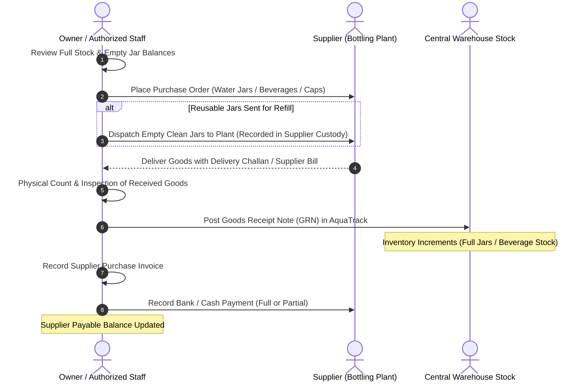
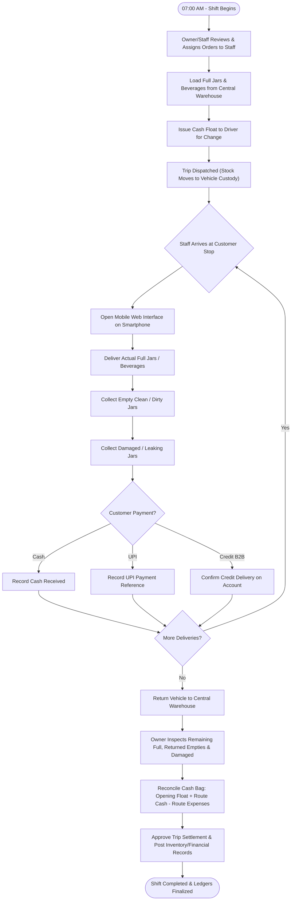
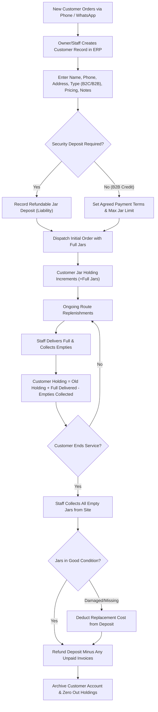
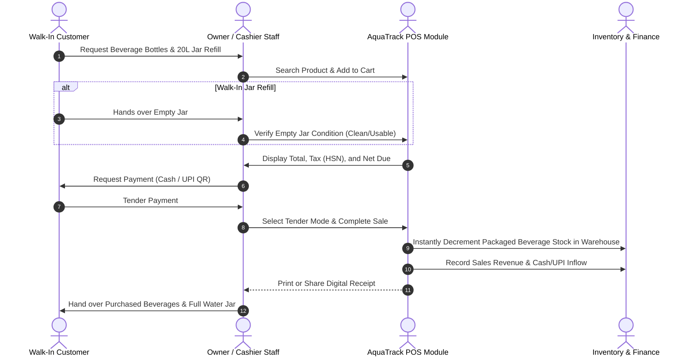
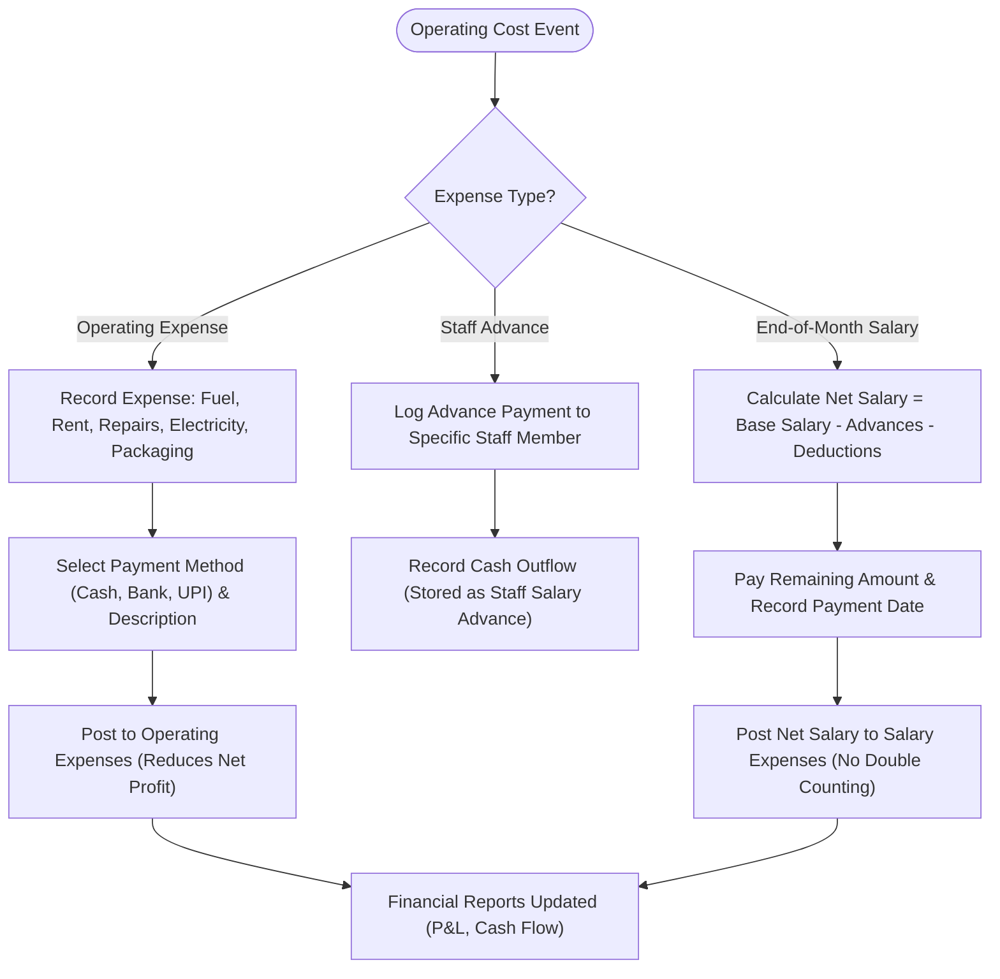

# BUSINESS WORKFLOWS — AquaTrack ERP
**Single-Location Water Distribution & Inventory Management System**

---

## Workflow 1: Single-Warehouse Procurement & Supplier Purchases

This workflow governs inventory replenishment from bottling plants and packaging suppliers into the single central warehouse.

---

## Workflow 2: Daily Delivery Route & Mobile Staff Execution

The primary daily distribution heartbeat connecting the single central warehouse, delivery vehicles, and customers.

---

## Workflow 3: Customer Management & Jar Tracking (No Customer Login)

Customers do not register or log in. All customer records, deliveries, and jar collections are managed internally by the Owner and staff.

---

## Workflow 4: Point of Sale (POS) Walk-In Sales

Quick counter sales at the central warehouse for packaged beverages, bottled water, and walk-in 20L refills.

---

## Workflow 5: Staff Salary & Operating Expense Settlement

Simple financial tracking of staff compensation and facility operating expenses.

