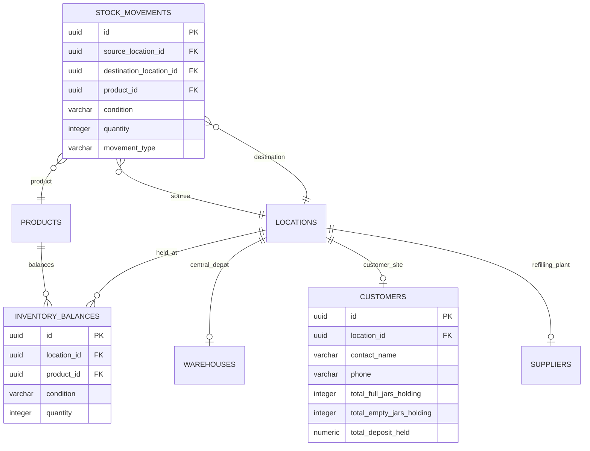
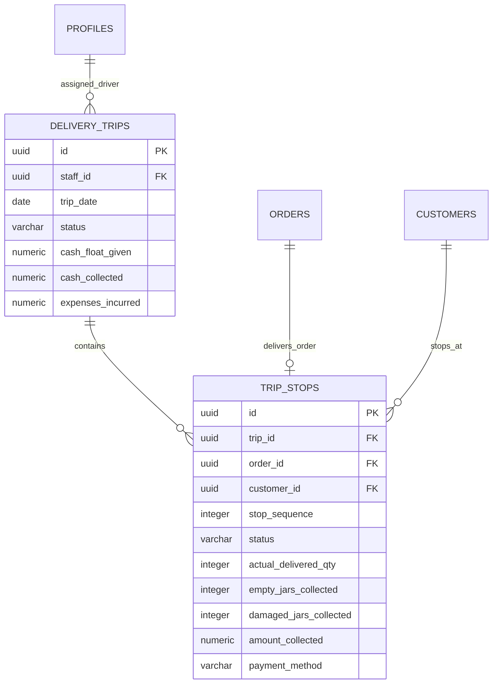

# DATABASE RELATIONSHIPS & ER DIAGRAMS — AquaTrack ERP
**Single-Location Water Distribution & Inventory Management System**

---

## 1. Master System Entity Relationships

AquaTrack ERP connects physical stock locations, reusable container assets, route operations, procurement, counter sales, and financial records within a simplified single-location architecture.

```mermaid
erDiagram
    PROFILES ||--o{ ORDERS : "creates_or_assigned"
    PROFILES ||--o{ DELIVERY_TRIPS : "executes"
    PROFILES ||--o{ POS_SALES : "tenders"
    PROFILES ||--o{ PAYMENTS : "receives"
    PROFILES ||--o{ PURCHASES : "creates"
    PROFILES ||--o{ EXPENSES : "logs"
    PROFILES ||--o{ STAFF_SALARIES : "compensated_by"
    PROFILES ||--o{ STAFF_ADVANCES : "draws"

    LOCATIONS ||--o| WAREHOUSES : "houses"
    LOCATIONS ||--o| CUSTOMERS : "custody_at"
    LOCATIONS ||--o| SUPPLIERS : "plant_custody"

    LOCATIONS ||--o{ INVENTORY_BALANCES : "stores"
    PRODUCTS ||--o{ INVENTORY_BALANCES : "stocked_as"

    LOCATIONS ||--o{ STOCK_MOVEMENTS : "source_location"
    LOCATIONS ||--o{ STOCK_MOVEMENTS : "destination_location"
    PRODUCTS ||--o{ STOCK_MOVEMENTS : "moves"

    CUSTOMERS ||--o{ ORDERS : "places"
    ORDERS ||--o{ ORDER_ITEMS : "contains"
    PRODUCTS ||--o{ ORDER_ITEMS : "item_product"

    DELIVERY_TRIPS ||--o{ TRIP_STOPS : "sequences"
    ORDERS ||--o| TRIP_STOPS : "delivers"
    CUSTOMERS ||--o{ TRIP_STOPS : "destination"

    POS_SALES ||--o{ POS_SALE_ITEMS : "contains"
    PRODUCTS ||--o{ POS_SALE_ITEMS : "sold_as"

    CUSTOMERS ||--o{ PAYMENTS : "remits"
    ORDERS ||--o{ PAYMENTS : "satisfies"

    SUPPLIERS ||--o{ PURCHASES : "bills"
    PURCHASES ||--o{ PURCHASE_ITEMS : "contains"
    PRODUCTS ||--o{ PURCHASE_ITEMS : "procured_product"
    SUPPLIERS ||--o{ SUPPLIER_PAYMENTS : "paid_by"

    CUSTOMERS ||--o{ CUSTOMER_SPECIAL_PRICES : "negotiates"
    PRODUCTS ||--o{ CUSTOMER_SPECIAL_PRICES : "priced_for"
```

---

## 2. Custody & Reusable Jar Relationships

---

## 3. Delivery Route & Trip Stop Linkage

