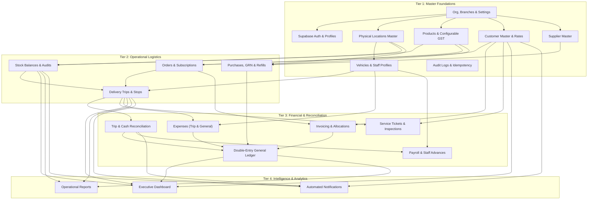

# MODULE DEPENDENCIES & INITIALIZATION GRAPH — AquaTrack ERP
**Version 2.0 (Post-Review & Audited)**

---

## 1. High-Level Dependency Tiers (All 22 Modules Mapped)

To build, test, and deploy AquaTrack ERP without architectural deadlocks, all 22 modules are categorized into four hierarchical tiers:

```
+-----------------------------------------------------------------------------------+
|  TIER 4: ANALYTICS, REPORTING & NOTIFICATIONS (Leaf Modules)                      |
|  - Module 1: Dashboard & KPIs        - Module 18: Reports & Analytics             |
|  - Module 19: Automated Notifications                                             |
+-----------------------------------------------------------------------------------+
                                        ▲
                                        │
+-----------------------------------------------------------------------------------+
|  TIER 3: FINANCIAL SETTLEMENT, BILLING & PAYROLL (Downstream Engines)             |
|  - Module 12: Payments & Allocations - Module 13: Expense Management (Trip/General)|
|  - Module 14: Double-Entry GL        - Module 15: Salary & Payroll Runs           |
|  - Module 17: Service Tickets & Quality Inspections                               |
+-----------------------------------------------------------------------------------+
                                        ▲
                                        │
+-----------------------------------------------------------------------------------+
|  TIER 2: OPERATIONAL WORKFLOWS & INVENTORY (Core Business Operations)             |
|  - Module 5: Inventory & Audits      - Module 7: Purchases, GRN & Plant Refills   |
|  - Module 8: Orders & Subscriptions  - Module 9: Delivery Trips & Route Dispatch  |
|  - Module 10: Jar Custody & Deposits                                              |
+-----------------------------------------------------------------------------------+
                                        ▲
                                        │
+-----------------------------------------------------------------------------------+
|  TIER 1: FOUNDATION & MASTER DATA (Independent Roots)                             |
|  - Organization & Branches           - Module 2: Customer Master & Special Prices |
|  - Module 3: Supplier Master         - Module 4: Products & Configurable GST      |
|  - Module 6: Locations & Warehouses  - Module 11: Staff Profiles & Roles          |
|  - Module 16: Vehicles & Maintenance - Module 20: User Management & RBAC          |
|  - Module 21: Business Settings      - Module 22: Audit Logs & Idempotency        |
+-----------------------------------------------------------------------------------+
```

---

## 2. Directed Acyclic Graph (DAG) of Module Dependencies



---

## 3. Potential Circular Dependency Risks & Decoupling Strategies

### Risk 1: Customer Balances vs. Delivery Trip Stops
- **Issue:** An order completion in a trip stop affects the customer's jar balance and financial ledger.
- **Decoupling Strategy:** All balance modifications are mediated through `stock_movements` and `payment_allocations` via database stored procedures. Neither domain imports the other's business services directly.

### Risk 2: Driver En-Route Expenses vs. Accounting General Ledger
- **Issue:** Drivers log fuel expenses on mobile, which are then audited during evening settlement and finally posted as journal entries.
- **Decoupling Strategy:** `trip_expenses` acts as an operational staging table. It does not touch the General Ledger until the cashier approves `trip_settlements`, which triggers a decoupled accounting event.

### Risk 3: Cash Shortage Deductions vs. Monthly Payroll Runs
- **Issue:** Driver cash shortages accumulate across daily trips and must be recovered during end-of-month payroll.
- **Decoupling Strategy:** Daily shortages are recorded in the independent `staff_advances` table with a status of `PENDING_RECOVERY`. The `payroll` module queries this table read-only during the payroll calculation cycle without coupling to individual trip records.
