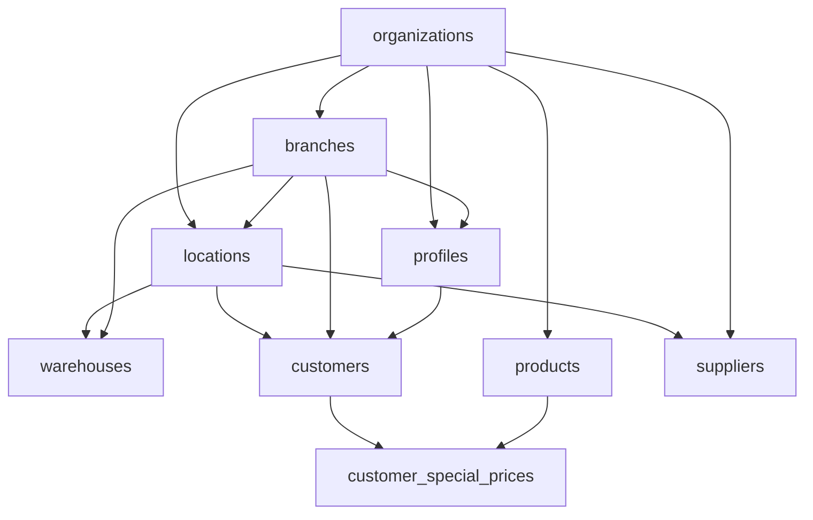

# AquaTrack ERP — Phase 4A Database Plan & Master Data Architecture
**Document Version:** 1.0.0  
**Phase:** 4A — Database Foundation & Master Data Layer  
**Status:** Prepared & Pending Explicit Approval Before Application  
**Date:** November 2026  

---

## 1. Executive Overview & Scope Isolation

Phase 4A establishes the core relational database foundation for **AquaTrack ERP** on PostgreSQL 15+ hosted on Supabase.

In strict adherence to the project instructions, Phase 4A **does not implement all 38 tables** or complex transactional ledgers (such as stock movements, double-entry journal vouchers, delivery trips, and invoicing). Instead, Phase 4A isolates and constructs the master data layer upon which all downstream operational phases depend.

### Phase 4A Tables (9 Foundational Entities):
```
+-----------------------------------------------------------------------------------+
|                               PHASE 4A MASTER ENTITIES                            |
+-----------------------------------------------------------------------------------+
|  1. organizations            - Top-level business entity master (tenant partition) |
|  2. branches                 - Operating branch depots under an organization      |
|  3. profiles                 - Extended auth users across all 7 RBAC roles        |
|  4. locations                - Canonical parent entity for all physical custody   |
|  5. warehouses               - Physical storage facilities (grounded by location) |
|  6. customers                - B2C residential & B2B corporate customer master     |
|  7. suppliers                - Water packaging & bottling plant supplier master   |
|  8. products                 - Product catalog with configurable GST & HSN        |
|  9. customer_special_prices  - Customer-specific negotiated price contracts       |
+-----------------------------------------------------------------------------------+
```

---

## 2. Table Dependency Graph & Creation Sequence

To eliminate foreign key circular deadlocks and ensure referential integrity, migrations must execute in this exact sequence:



### Parent-Child Location Architecture (Invariant Check)
In legacy systems, circular dependencies often exist between `locations` and `warehouses` (e.g. `locations.warehouse_id` vs `warehouses.location_id`).
In AquaTrack ERP:
1. `locations` is the **strict canonical parent**. It holds zero foreign keys to child business entities.
2. `warehouses`, `customers`, and `suppliers` hold `location_id UUID NOT NULL UNIQUE REFERENCES locations(id) ON DELETE RESTRICT`.
3. Creating a warehouse, customer, or supplier follows an atomic two-step procedure:
   - **Step 1:** Insert row into `locations` (returns `location_id`).
   - **Step 2:** Insert child record referencing `location_id`.

---

## 3. Schema Definitions & Table Specifications

### 3.1 `organizations` (Business Entity Master)
Legal entity partition key (`business_id`) ensuring multi-tenant readiness:
```sql
CREATE TABLE public.organizations (
    id UUID PRIMARY KEY DEFAULT gen_random_uuid(),
    name VARCHAR(255) NOT NULL,
    trade_name VARCHAR(255),
    tax_id VARCHAR(50),
    currency VARCHAR(3) NOT NULL DEFAULT 'INR',
    created_at TIMESTAMPTZ NOT NULL DEFAULT now(),
    updated_at TIMESTAMPTZ NOT NULL DEFAULT now()
);
```

### 3.2 `branches` (Operating Depots)
Distribution centers and depots operating under an organization:
```sql
CREATE TABLE public.branches (
    id UUID PRIMARY KEY DEFAULT gen_random_uuid(),
    organization_id UUID NOT NULL REFERENCES public.organizations(id) ON DELETE RESTRICT,
    name VARCHAR(150) NOT NULL,
    code VARCHAR(20) NOT NULL,
    address TEXT NOT NULL,
    phone VARCHAR(20) NOT NULL,
    email VARCHAR(255),
    is_active BOOLEAN NOT NULL DEFAULT true,
    created_at TIMESTAMPTZ NOT NULL DEFAULT now(),
    updated_at TIMESTAMPTZ NOT NULL DEFAULT now(),
    CONSTRAINT uq_branches_org_code UNIQUE (organization_id, code)
);
```

### 3.3 `profiles` (User Profiles & 7 RBAC Roles)
Extends Supabase `auth.users` with organization association and role validation:
```sql
CREATE TABLE public.profiles (
    id UUID PRIMARY KEY REFERENCES auth.users(id) ON DELETE CASCADE,
    organization_id UUID NOT NULL REFERENCES public.organizations(id) ON DELETE RESTRICT,
    branch_id UUID REFERENCES public.branches(id) ON DELETE SET NULL,
    full_name VARCHAR(150) NOT NULL,
    phone VARCHAR(20) NOT NULL UNIQUE,
    role VARCHAR(30) NOT NULL CHECK (
        role IN (
            'super_admin',
            'branch_manager',
            'dispatcher',
            'warehouse_staff',
            'delivery_driver',
            'accountant',
            'customer'
        )
    ),
    avatar_url TEXT,
    is_active BOOLEAN NOT NULL DEFAULT true,
    created_at TIMESTAMPTZ NOT NULL DEFAULT now(),
    updated_at TIMESTAMPTZ NOT NULL DEFAULT now()
);
```

### 3.4 `locations` (Physical Custody Parent)
Parent custody location for all stock tracking:
```sql
CREATE TABLE public.locations (
    id UUID PRIMARY KEY DEFAULT gen_random_uuid(),
    organization_id UUID NOT NULL REFERENCES public.organizations(id) ON DELETE RESTRICT,
    branch_id UUID REFERENCES public.branches(id) ON DELETE RESTRICT,
    type VARCHAR(30) NOT NULL CHECK (
        type IN ('WAREHOUSE', 'VEHICLE', 'CUSTOMER', 'SUPPLIER', 'SCRAP_YARD')
    ),
    name VARCHAR(150) NOT NULL,
    address TEXT,
    is_active BOOLEAN NOT NULL DEFAULT true,
    created_at TIMESTAMPTZ NOT NULL DEFAULT now(),
    updated_at TIMESTAMPTZ NOT NULL DEFAULT now()
);
```

### 3.5 `warehouses` (Physical Depots & Hubs)
```sql
CREATE TABLE public.warehouses (
    id UUID PRIMARY KEY DEFAULT gen_random_uuid(),
    organization_id UUID NOT NULL REFERENCES public.organizations(id) ON DELETE RESTRICT,
    location_id UUID NOT NULL UNIQUE REFERENCES public.locations(id) ON DELETE RESTRICT,
    branch_id UUID NOT NULL REFERENCES public.branches(id) ON DELETE RESTRICT,
    name VARCHAR(150) NOT NULL,
    is_main_depot BOOLEAN NOT NULL DEFAULT false,
    created_at TIMESTAMPTZ NOT NULL DEFAULT now(),
    updated_at TIMESTAMPTZ NOT NULL DEFAULT now(),
    CONSTRAINT uq_warehouses_branch_name UNIQUE (branch_id, name)
);
```

### 3.6 `customers` (Residential & Commercial Master)
```sql
CREATE TABLE public.customers (
    id UUID PRIMARY KEY DEFAULT gen_random_uuid(),
    organization_id UUID NOT NULL REFERENCES public.organizations(id) ON DELETE RESTRICT,
    branch_id UUID NOT NULL REFERENCES public.branches(id) ON DELETE RESTRICT,
    location_id UUID NOT NULL UNIQUE REFERENCES public.locations(id) ON DELETE RESTRICT,
    profile_id UUID UNIQUE REFERENCES public.profiles(id) ON DELETE SET NULL,
    customer_type VARCHAR(10) NOT NULL CHECK (customer_type IN ('B2C', 'B2B')),
    business_name VARCHAR(200),
    contact_name VARCHAR(150) NOT NULL,
    phone VARCHAR(20) NOT NULL,
    email VARCHAR(255),
    gstin VARCHAR(30),
    credit_limit NUMERIC(12,2) NOT NULL DEFAULT 0.00 CHECK (credit_limit >= 0),
    max_jar_limit INTEGER NOT NULL DEFAULT 5 CHECK (max_jar_limit >= 0),
    payment_terms_days INTEGER NOT NULL DEFAULT 0 CHECK (payment_terms_days >= 0),
    current_balance NUMERIC(12,2) NOT NULL DEFAULT 0.00,
    total_jars_holding INTEGER NOT NULL DEFAULT 0 CHECK (total_jars_holding >= 0),
    total_deposit_held NUMERIC(12,2) NOT NULL DEFAULT 0.00 CHECK (total_deposit_held >= 0),
    default_route_id UUID,
    is_active BOOLEAN NOT NULL DEFAULT true,
    created_at TIMESTAMPTZ NOT NULL DEFAULT now(),
    updated_at TIMESTAMPTZ NOT NULL DEFAULT now(),
    CONSTRAINT chk_b2b_business_name CHECK (customer_type = 'B2C' OR (customer_type = 'B2B' AND business_name IS NOT NULL)),
    CONSTRAINT uq_customers_org_phone UNIQUE (organization_id, phone)
);
```

### 3.7 `suppliers` (Bottling Plants & Packaging Vendors)
```sql
CREATE TABLE public.suppliers (
    id UUID PRIMARY KEY DEFAULT gen_random_uuid(),
    organization_id UUID NOT NULL REFERENCES public.organizations(id) ON DELETE RESTRICT,
    location_id UUID NOT NULL UNIQUE REFERENCES public.locations(id) ON DELETE RESTRICT,
    name VARCHAR(200) NOT NULL,
    contact_person VARCHAR(150) NOT NULL,
    phone VARCHAR(20) NOT NULL,
    email VARCHAR(255),
    gstin VARCHAR(30),
    payment_terms_days INTEGER NOT NULL DEFAULT 15 CHECK (payment_terms_days >= 0),
    current_payable NUMERIC(12,2) NOT NULL DEFAULT 0.00,
    jars_in_custody INTEGER NOT NULL DEFAULT 0 CHECK (jars_in_custody >= 0),
    is_active BOOLEAN NOT NULL DEFAULT true,
    created_at TIMESTAMPTZ NOT NULL DEFAULT now(),
    updated_at TIMESTAMPTZ NOT NULL DEFAULT now(),
    CONSTRAINT uq_suppliers_org_name UNIQUE (organization_id, name)
);
```

### 3.8 `products` (Configurable Tax & Catalog Master)
```sql
CREATE TABLE public.products (
    id UUID PRIMARY KEY DEFAULT gen_random_uuid(),
    organization_id UUID NOT NULL REFERENCES public.organizations(id) ON DELETE RESTRICT,
    sku VARCHAR(50) NOT NULL,
    name VARCHAR(150) NOT NULL,
    category VARCHAR(30) NOT NULL CHECK (
        category IN ('REFILLABLE_WATER', 'EMPTY_JAR_ASSET', 'PACKAGED_WATER', 'DISPENSER_EQUIPMENT', 'CONSUMABLE', 'SERVICE', 'BEVERAGE')
    ),
    unit_of_measure VARCHAR(20) NOT NULL DEFAULT 'UNIT',
    default_sale_price NUMERIC(12,2) NOT NULL CHECK (default_sale_price >= 0),
    deposit_amount NUMERIC(12,2) NOT NULL DEFAULT 0.00 CHECK (deposit_amount >= 0),
    cost_price NUMERIC(12,2) NOT NULL DEFAULT 0.00 CHECK (cost_price >= 0),
    hsn_code VARCHAR(20) NOT NULL,
    gst_rate NUMERIC(5,2) NOT NULL CHECK (gst_rate >= 0),
    cgst_rate NUMERIC(5,2) NOT NULL CHECK (cgst_rate >= 0),
    sgst_rate NUMERIC(5,2) NOT NULL CHECK (sgst_rate >= 0),
    igst_rate NUMERIC(5,2) NOT NULL CHECK (igst_rate >= 0),
    cess_rate NUMERIC(5,2) NOT NULL DEFAULT 0.00 CHECK (cess_rate >= 0),
    is_reusable_jar BOOLEAN NOT NULL DEFAULT false,
    is_active BOOLEAN NOT NULL DEFAULT true,
    created_at TIMESTAMPTZ NOT NULL DEFAULT now(),
    updated_at TIMESTAMPTZ NOT NULL DEFAULT now(),
    CONSTRAINT uq_products_org_sku UNIQUE (organization_id, sku),
    CONSTRAINT chk_products_gst_balance CHECK (gst_rate = cgst_rate + sgst_rate)
);
```

### 3.9 `customer_special_prices` (Negotiated Contract Pricing)
```sql
CREATE TABLE public.customer_special_prices (
    id UUID PRIMARY KEY DEFAULT gen_random_uuid(),
    organization_id UUID NOT NULL REFERENCES public.organizations(id) ON DELETE RESTRICT,
    customer_id UUID NOT NULL REFERENCES public.customers(id) ON DELETE CASCADE,
    product_id UUID NOT NULL REFERENCES public.products(id) ON DELETE RESTRICT,
    special_price NUMERIC(12,2) NOT NULL CHECK (special_price >= 0),
    effective_from DATE NOT NULL DEFAULT CURRENT_DATE,
    effective_to DATE,
    created_at TIMESTAMPTZ NOT NULL DEFAULT now(),
    updated_at TIMESTAMPTZ NOT NULL DEFAULT now(),
    CONSTRAINT chk_csp_date_range CHECK (effective_to IS NULL OR effective_to >= effective_from),
    CONSTRAINT uq_csp_customer_product_date UNIQUE (customer_id, product_id, effective_from)
);
```

---

## 4. Row-Level Security (RLS) Architecture & Security Definer Functions

### 4.1 Security Definer Helper Functions
```sql
-- Retrieve authenticated caller's role
CREATE OR REPLACE FUNCTION public.get_user_role()
RETURNS VARCHAR AS $$
  SELECT role FROM public.profiles WHERE id = auth.uid();
$$ LANGUAGE sql STABLE SECURITY DEFINER;

-- Retrieve authenticated caller's organization_id (business_id)
CREATE OR REPLACE FUNCTION public.get_user_org_id()
RETURNS UUID AS $$
  SELECT organization_id FROM public.profiles WHERE id = auth.uid();
$$ LANGUAGE sql STABLE SECURITY DEFINER;

-- Retrieve authenticated caller's branch_id
CREATE OR REPLACE FUNCTION public.get_user_branch_id()
RETURNS UUID AS $$
  SELECT branch_id FROM public.profiles WHERE id = auth.uid();
$$ LANGUAGE sql STABLE SECURITY DEFINER;

-- Retrieve authenticated caller's customer_id
CREATE OR REPLACE FUNCTION public.get_user_customer_id()
RETURNS UUID AS $$
  SELECT id FROM public.customers WHERE profile_id = auth.uid();
$$ LANGUAGE sql STABLE SECURITY DEFINER;
```

### 4.2 Matrix of RLS Policies per Table

| Table | SELECT Policy | INSERT / UPDATE Policy |
| :--- | :--- | :--- |
| `organizations` | `id = get_user_org_id()` | `id = get_user_org_id() AND get_user_role() = 'super_admin'` |
| `branches` | `organization_id = get_user_org_id()` | `organization_id = get_user_org_id() AND get_user_role() = 'super_admin'` |
| `profiles` | `id = auth.uid() OR (organization_id = get_user_org_id() AND get_user_role() IN ('super_admin', 'branch_manager', 'dispatcher', 'accountant'))` | `id = auth.uid() OR (organization_id = get_user_org_id() AND get_user_role() = 'super_admin')` |
| `locations` | `organization_id = get_user_org_id() AND (get_user_role() != 'customer' OR id = (SELECT location_id FROM public.customers WHERE profile_id = auth.uid()))` | `organization_id = get_user_org_id() AND get_user_role() IN ('super_admin', 'branch_manager', 'dispatcher', 'warehouse_staff')` |
| `warehouses` | `organization_id = get_user_org_id() AND get_user_role() != 'customer'` | `organization_id = get_user_org_id() AND get_user_role() IN ('super_admin', 'branch_manager')` |
| `customers` | `organization_id = get_user_org_id() AND (profile_id = auth.uid() OR get_user_role() IN ('super_admin', 'branch_manager', 'dispatcher', 'accountant', 'delivery_driver', 'warehouse_staff'))` | `organization_id = get_user_org_id() AND (profile_id = auth.uid() OR get_user_role() IN ('super_admin', 'branch_manager', 'dispatcher', 'accountant'))` |
| `suppliers` | `organization_id = get_user_org_id() AND get_user_role() IN ('super_admin', 'branch_manager', 'accountant', 'dispatcher', 'warehouse_staff')` | `organization_id = get_user_org_id() AND get_user_role() IN ('super_admin', 'branch_manager', 'accountant')` |
| `products` | `organization_id = get_user_org_id()` (Customers can view catalog; cost prices hidden via API projections) | `organization_id = get_user_org_id() AND get_user_role() IN ('super_admin', 'branch_manager')` |
| `customer_special_prices`| `organization_id = get_user_org_id() AND (customer_id = get_user_customer_id() OR get_user_role() IN ('super_admin', 'branch_manager', 'dispatcher', 'accountant'))` | `organization_id = get_user_org_id() AND get_user_role() IN ('super_admin', 'branch_manager', 'accountant')` |

---

## 5. Secure Initial Super Admin Provisioning Procedure

### Zero-Vulnerability Security Mandate:
- Public customer registration (`/register`) or login (`/login`) **cannot** create or claim a `super_admin` role.
- Self-elevation is prevented by RLS: inserting or updating `role = 'super_admin'` requires either:
  1. An existing active `super_admin` caller.
  2. The database owner executing the provisioning RPC via Supabase Service Role from a secure CLI script.

### Two-Step Provisioning Procedure:
1. **Initial Organization & Root Super Admin Seeding Script (`scripts/seed-initial-admin.mjs`):**
   - Reads private credentials from local `.env.local` inside Node.js server context.
   - Creates the legal organization (`AquaTrack Distribution Ltd`).
   - Creates the default headquarter branch (`Central Hub #1`).
   - Provisions the primary administrator user in Supabase `auth.users` via `supabase.auth.admin.createUser()`.
   - Links the verified UUID to `public.profiles` with `role = 'super_admin'`.
   - Issues a one-time password reset link to the owner's private email address.

---

## 6. Migration Rollout & Rollback Strategy

- **Migration Path:** `supabase/migrations/20261102000001_phase4a_foundation.sql`
- **Reversibility / Rollback Script:** `supabase/migrations/rollback/20261102000001_phase4a_rollback.sql`
- **Pre-Flight Validation:** Run local SQL syntax and lint check before applying to remote Supabase database.
- **Strict Compliance:** Execution against remote database will **only take place after explicit user approval**.
