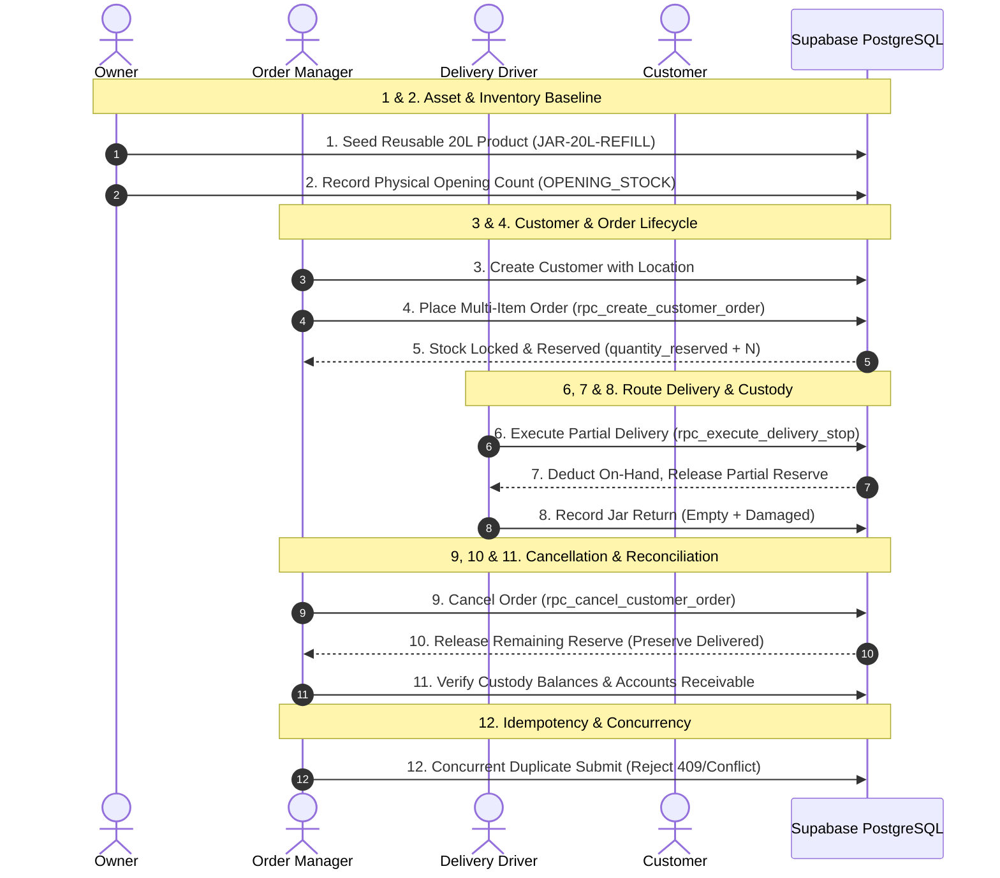

# AquaTrack ERP — Phase 4 Comprehensive Integration Test Plan

**Document Version:** 1.0.0  
**Target Environment:** Connected Supabase Instance (`bplpyitmcqqebpdyochz.supabase.co`)  
**Scope:** Phase 4 End-to-End Operational Lifecycle & Invariant Verification  
**Security Mandate:** All tests execute as authenticated persona JWTs. Service role key is strictly prohibited for simulating user operations to ensure authentic Row-Level Security (RLS) enforcement.

---

## 1. Overview & Objectives

This document establishes the official test plan to validate Phase 4 database alignment, business logic invariants, and transactional stored procedures.

The suite verifies the complete lifecycle of water distribution:
1. Reusable asset creation.
2. Safe physical inventory initialization.
3. Customer onboarding and location mapping.
4. Multi-item order creation with inventory reservations.
5. Route delivery stop execution with partial deliveries.
6. Empty and damaged jar custody tracking ($N \text{ dropped} \neq N \text{ collected}$).
7. Order cancellation with selective undelivered reservation release.
8. Double-entry financial and inventory ledger consistency.
9. Concurrency and idempotency protection against duplicate requests.

---

## 2. Test Execution Personas & Authorization Matrix

To guarantee genuine RLS enforcement, operations are split across dedicated test users authenticated via standard Supabase Auth tokens (`/auth/v1/token?grant_type=password`):

| Persona Email | Profile Role | Granted Permissions | Testing Scope |
|---|---|---|---|
| `owner@aquatrack.test` | `owner` | Full Administrative Privileges | Business settings, product creation, scrap authorization |
| `manager@aquatrack.test` | `staff` | `can_manage_orders`, `can_manage_customers` | Order placement, order cancellation, customer updates |
| `wh.staff@aquatrack.test` | `staff` | `can_warehouse` | Warehouse transfers, jar sanitization, stock adjustments |
| `driver@aquatrack.test` | `staff` | `can_deliveries` | Route viewing, delivery stop completion, doorstep payment |
| `unauth.staff@aquatrack.test` | `staff` | None (Zero administrative flags) | Negative security testing (RLS barrier verification) |

> [!IMPORTANT]
> The Supabase `service_role` key bypasses all RLS policies (`auth.uid() IS NULL` / `rolsuper`). Using it for application journey testing invalidates security validation. The service role key is reserved solely for ephemeral fixture setup and post-test teardown.

---

## 3. Detailed Scenario Test Specifications (12 Phases)

---

### Scenario 1 — Create Reusable Jar Product
- **Executor:** `owner@aquatrack.test`
- **Action:** Execute product creation via `createProduct()` service action.
- **Payload:**
  - SKU: `JAR-20L-REFILL`
  - Name: `20L Polycarbonate Water Jar Refill`
  - Category: `REFILLABLE_WATER`
  - Unit of Measure: `UNIT`
  - Sale Price: `80.00` INR
  - Deposit: `150.00` INR (must match `business_settings.default_jar_deposit`)
  - GST: `18.00%` (CGST: `9.00%`, SGST: `9.00%`, IGST: `0.00%`)
  - `is_reusable_jar`: `true`
- **Expected Results:**
  - HTTP 201 / Success.
  - Table `public.products` contains 1 row with `is_reusable_jar = true`.
  - Constraint `chk_products_gst_balance` verified (`18.00 = 9.00 + 9.00`).

---

### Scenario 2 — Initialize Inventory Using Confirmed Count
- **Executor:** `owner@aquatrack.test` or `wh.staff@aquatrack.test`
- **Action:** Record opening physical stock via authorized transaction.
- **Physical Count:** 100 units of 20L jars in warehouse.
- **Call:** `rpc_record_jar_movement` or `rpc_adjust_inventory_stock`.
  - `p_product_id`: `JAR-20L-REFILL` ID
  - `p_source_location_id`: Default Central Warehouse Location ID
  - `p_destination_location_id`: Default Central Warehouse Location ID
  - `p_condition_from`: `FULL_USABLE`
  - `p_condition_to`: `FULL_USABLE`
  - `p_quantity`: `100`
  - `p_movement_type`: `OPENING_STOCK`
- **Expected Results:**
  - `inventory_balances.quantity_on_hand` updates from `0` to `100`.
  - `inventory_balances.quantity_reserved` remains `0`.
  - Immutable audit line recorded in `public.stock_movements`.

---

### Scenario 3 — Create Customer with Dual-Entity Custody Location
- **Executor:** `manager@aquatrack.test`
- **Action:** Invoke `rpc_create_customer_with_location`.
- **Payload:**
  - Name: `Grand Horizon Hotel & Suites`
  - Phone: `+91 98450 11223`
  - Customer Type: `B2B`
  - Credit Limit: `25000.00`
  - Payment Terms: `30` days
  - Address: `74 Commercial Blvd, Bangalore`
- **Expected Results:**
  - Exactly 1 row inserted into `public.locations` with `type = 'CUSTOMER'`.
  - Exactly 1 row inserted into `public.customers` linked by `location_id`.
  - All jar custody balances initialize to zero (`total_full_jars_holding = 0`, etc.).

---

### Scenario 4 — Create Order with Multiple Products
- **Executor:** `manager@aquatrack.test`
- **Action:** Invoke `rpc_create_customer_order`.
- **Payload:**
  - Customer ID: Created B2B Customer
  - Delivery Date: Current Date + 1
  - Items:
    - Item 1: `JAR-20L-REFILL` x 20 units @ `80.00` INR (GST 18%)
    - Item 2: Packaged Water / Accessory x 10 units @ `30.00` INR (GST 18%)
  - Idempotency Key: `IDEM-ORD-TEST-0001`
- **Expected Results:**
  - Order created in `ASSIGNED` or `PENDING` status.
  - Subtotal: `(20 * 80) + (10 * 30) = 1600 + 300 = 1900.00`.
  - Tax (18%): `342.00`. Total: `2242.00` INR.
  - Accrual invoice created in `public.invoices` with `status = 'UNPAID'`, `balance_due = 2242.00`.

---

### Scenario 5 — Verify Inventory Reservations
- **Action:** Query `public.inventory_balances` for `JAR-20L-REFILL` at central warehouse.
- **Verification Invariant:**
  - `quantity_on_hand`: `100` (unchanged until delivery).
  - `quantity_reserved`: `20` (atomically incremented by order).
  - `available_stock = quantity_on_hand - quantity_reserved = 80`.
- **Negative Invariant:** Attempting to place an order for `85` units must immediately be rejected by PostgreSQL with exception `"Insufficient available inventory"`.

---

### Scenario 6 — Execute Partial Delivery at Customer Doorstep
- **Executor:** `driver@aquatrack.test`
- **Action:** Invoke `rpc_execute_delivery_stop`.
- **Parameters:**
  - `p_stop_id`: Active delivery stop UUID
  - `p_actual_delivered`: `12` (out of 20 ordered jars)
  - `p_empty_jars`: `0`
  - `p_damaged_jars`: `0`
  - `p_payment_amount`: `0.00` (B2B credit customer)
- **Expected Results:**
  - Stop status updates to `COMPLETED`.
  - Order status updates to `PARTIALLY_DELIVERED`.
  - Delivered quantity stamped: `12`.
  - Remaining ordered quantity: `8`.

---

### Scenario 7 — Verify Delivered Quantities & Remaining Reservations
- **Action:** Inspect physical inventory and customer custody holdings.
- **Invariants Checked:**
  - `inventory_balances.quantity_on_hand`: Decremented by `12` (`100 - 12 = 88`).
  - `inventory_balances.quantity_reserved`: Decremented by `12` (`20 - 12 = 8`).
  - `available_stock`: `88 - 8 = 80` (remains conserved).
  - Customer custody: `customers.total_full_jars_holding` incremented from `0` to `12`.
  - Total physical jars in system:
    $$\text{Warehouse Stock (88)} + \text{Customer Custody (12)} = 100 \quad (\Delta \text{Jars} = 0)$$

---

### Scenario 8 — Record Jar Returns (Empty & Damaged)
- **Executor:** `driver@aquatrack.test`
- **Action:** Return to customer site on next stop; collect returned containers.
- **Parameters:**
  - Customer holds: `12` full jars.
  - Customer returns: `5` empty clean jars and `2` damaged jars.
- **Execution:** Invoked via `rpc_record_jar_movement` or delivery stop jar reconciliation.
- **Expected Results:**
  - Customer custody:
    - Full jars holding: `12 - 7 = 5`.
    - Empty clean holding: `5 - 5 = 0` (or transferred to driver vehicle).
  - Collected empty jars and damaged jars tracked as independent variables.
  - Driver vehicle location gains `5` empty clean jars and `2` damaged jars.
  - Customer deposit liability remains intact ($N$ returned $\le N$ held).

---

### Scenario 9 — Cancel an Eligible Partially Delivered Order
- **Executor:** `manager@aquatrack.test`
- **Action:** Customer requests cancellation of the undelivered remainder (8 jars) prior to second truck dispatch.
- **Call:** `cancelOrder({ order_id, reason: "Customer requested cancellation of remaining balance" })`.
- **Expected Results:**
  - Order status transitions from `PARTIALLY_DELIVERED` to `CANCELLED`.
  - Order notes updated with cancellation audit tag.
  - Pending stops transition to `CANCELLED`.
  - Previously `COMPLETED` delivery stop (delivering 12 jars) is **preserved**.

---

### Scenario 10 — Verify Selective Reservation Release
- **Action:** Query `public.inventory_balances` following cancellation.
- **Invariants Checked:**
  - Undelivered quantity calculation: $\text{Ordered (20)} - \text{Delivered (12)} = 8$.
  - `inventory_balances.quantity_reserved`: Decremented by exactly `8` (`8 - 8 = 0`).
  - `inventory_balances.quantity_on_hand`: Remains `88` (the 12 delivered jars are NOT restored to warehouse).
  - `available_stock = 88 - 0 = 88`.

---

### Scenario 11 — Verify Inventory and Custody Balances
- **Action:** Complete system balance audit across all tables.
- **Financial Balance Invariant:**
  - Accrual invoice: Unpaid balance adjusted or marked partially fulfilled.
  - Customer receivable balance: Reconciled to reflect only the 12 delivered units plus tax.
- **Custody Asset Invariant:**
  $$\text{Warehouse (88)} + \text{Driver Vehicle (7)} + \text{Customer Custody (5)} = 100$$
  Conservation of assets holds across all nodes. Zero jars fabricated or vanished.

---

### Scenario 12 — Verify Duplicate Requests and Concurrency
- **Action:**
  1. **Idempotency Replay:** Resubmit order creation with identical `p_idempotency_key = 'IDEM-ORD-TEST-0001'`.
     - *Expected:* Database returns existing order record without creating duplicate rows or double-reserving inventory.
  2. **Duplicate Cancellation Replay:** Call `cancelOrder` a second time on the already cancelled order.
     - *Expected:* Rejected with HTTP 400 / `"Order cannot be cancelled in 'CANCELLED' status."`
  3. **Concurrent Order Placement:** Fire 5 concurrent requests attempting to reserve `25` units each when only `88` are available.
     - *Expected:* Row-level locking (`ORDER BY product_id FOR UPDATE`) processes orders sequentially; the 4th order fails with `"Insufficient available inventory"`. No negative stock.

---

## 4. Test Teardown & Environment Cleanup

Following integration test execution:
1. **Isolated Data Removal:** All test records created with prefix `TEST-` or within test tenant scopes are deleted using the test runner cleanup hook.
2. **Invariants Verification:** Re-verify that central warehouse `is_default` remains intact and `public.products` contains only approved products.
3. **Audit Log Inspection:** Verify that `public.audit_logs` captured every status change, price override, and cancellation with user ID and timestamp.

