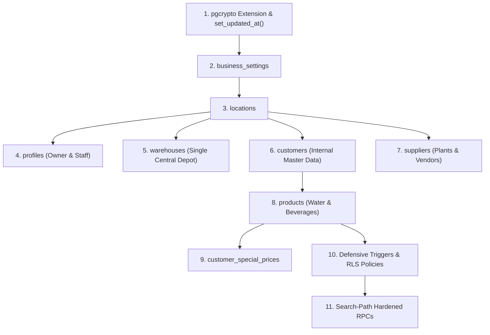

# REVISED DATABASE MIGRATION PLAN — AquaTrack ERP
**Single-Location Water Distribution & Inventory Management System**

**Document Reference:** `docs/REVISED_DATABASE_MIGRATION_PLAN.md`  
**Target Migration:** `supabase/migrations/20261102000001_phase4a_foundation.sql`  
**Rollback Script:** `supabase/migrations/rollback/20261102000001_phase4a_rollback.sql`  

---

## 1. Migration Overview & Design Principles

The Phase 4A foundational database layer is redesigned to support a **single-location business**:
1. **Single Business Entity:** `business_settings` holds the enterprise identity, GSTIN, and default configurations. The multi-tenant `organizations` table is eliminated.
2. **Single Warehouse:** Exactly one central warehouse record linked to a canonical warehouse location. The `branches` table and multi-warehouse complexity are eliminated.
3. **Internal Customer Master:** `customers` records represent internal accounts without customer authentication. The `profile_id` column, customer onboarding tokens table (`customer_onboarding_tokens`), and customer registration RPCs are eliminated.
4. **Two-Tier Profiles:** `profiles` supports `role IN ('owner', 'staff')` with modular permission flags (`can_pos`, `can_warehouse`, `can_manage_customers`, `can_manage_orders`).
5. **Rock-Solid Security:**
   - CIS benchmark baseline: `REVOKE CREATE ON SCHEMA public FROM PUBLIC;`.
   - All helper functions and RPCs enforce `SECURITY DEFINER SET search_path = ''`.
   - Service-role administrative path authenticated via `auth.role() = 'service_role' OR current_user IN ('postgres', 'supabase_admin')`.
   - RLS forced across all tables.
6. **Zero-Cascade Rollback:** Rollback script executes reverse-dependency drops without `CASCADE`, verifying that downstream operational records do not exist before dropping tables.

---

## 2. Table Creation Sequence & Schema Details

### Table Definitions (Phase 4A Foundational Master Data)

1. **`business_settings`:**
   - Single enterprise profile: `name`, `trade_name`, `tax_id` (GSTIN), `phone`, `email`, `address`, `currency` (INR), `default_jar_deposit`.
2. **`locations`:**
   - Physical custodians: `type IN ('WAREHOUSE', 'VEHICLE', 'CUSTOMER', 'SUPPLIER', 'SCRAP_YARD')`, `name`, `address`, `is_active`.
3. **`warehouses`:**
   - Single depot: `location_id REFERENCES locations(id) ON DELETE RESTRICT`, `name`, `address`, `is_default BOOLEAN DEFAULT true`.
4. **`profiles`:**
   - Extends `auth.users(id)`: `full_name`, `phone`, `role IN ('owner', 'staff')`, `avatar_url`, `is_active`, permissions (`can_pos`, `can_warehouse`, `can_manage_customers`, `can_manage_orders`), `salary_amount`, `salary_type`.
5. **`customers`:**
   - Internal master data: `location_id REFERENCES locations(id) ON DELETE RESTRICT`, `customer_type IN ('B2C', 'B2B')`, `business_name`, `contact_name`, `phone UNIQUE`, `email`, `address`, `delivery_instructions`, `gstin`, `credit_limit`, `max_jar_limit`, `payment_terms_days`, `current_balance`, `total_full_jars_holding`, `total_empty_jars_holding`, `total_deposit_held`, `notes`, `is_active`.
   - **No profile_id.**
6. **`suppliers`:**
   - Vendor directory: `location_id REFERENCES locations(id) ON DELETE RESTRICT`, `name UNIQUE`, `contact_person`, `phone`, `email`, `address`, `gstin`, `payment_terms_days`, `current_payable`, `jars_in_custody`, `is_active`.
7. **`products`:**
   - Product catalog: `sku UNIQUE`, `name`, `category IN ('REFILLABLE_WATER', 'EMPTY_JAR_ASSET', 'PACKAGED_WATER', 'BEVERAGE', 'DISPENSER_EQUIPMENT', 'CONSUMABLE', 'SERVICE')`, `unit_of_measure`, `default_sale_price`, `deposit_amount`, `cost_price`, `hsn_code`, `gst_rate`, `cgst_rate`, `sgst_rate`, `igst_rate`, `cess_rate`, `is_reusable_jar`, `is_active`.
   - Check constraint: `gst_rate = cgst_rate + sgst_rate`.
8. **`customer_special_prices`:**
   - Custom negotiated pricing: `customer_id REFERENCES customers(id) ON DELETE CASCADE`, `product_id REFERENCES products(id) ON DELETE RESTRICT`, `special_price`, `effective_from`, `effective_to`.

---

## 3. Defensive Triggers & Business Protection

1. **`trg_prevent_profile_privilege_escalation` on `profiles`:**
   - Rejects profile updates if an ordinary user attempts to alter their own `role`, permissions, or `is_active` status.
   - Allows trusted service-role updates (`auth.role() = 'service_role' OR current_user IN ('postgres', 'supabase_admin')`).
   - Prevents non-owner users from updating other staff accounts.
2. **`trg_prevent_product_hard_delete` on `products`:**
   - Enforces soft-deletion (`is_active = false`) to preserve historical invoice references and transaction ledgers.
3. **`trg_protect_customer_financial_fields` on `customers`:**
   - Prevents unauthorized modification of `credit_limit`, `current_balance`, `total_full_jars_holding`, `total_empty_jars_holding`, and `total_deposit_held`.
4. **`set_updated_at` on all tables:**
   - Automatically maintains `updated_at = pg_catalog.now()`.

---

## 4. Search-Path Hardened RPC Functions

1. **`rpc_create_customer_with_location(...)`:**
   - Atomically inserts a `CUSTOMER` entry into `locations`, then inserts the child record into `customers`.
   - If customer insertion fails, location creation rolls back atomically.
2. **`rpc_create_supplier_with_location(...)`:**
   - Atomically inserts a `SUPPLIER` entry into `locations`, then inserts the child record into `suppliers`.
3. **`rpc_create_warehouse_with_location(...)`:**
   - Atomically inserts a `WAREHOUSE` entry into `locations`, then inserts the child record into `warehouses`.

---

## 5. Row-Level Security (RLS) Policy Specifications

| Table | SELECT Policy | INSERT Policy | UPDATE Policy | DELETE Policy |
| :--- | :--- | :--- | :--- | :--- |
| **`business_settings`** | `authenticated` (Read Only) | Service Role / Postgres | `owner` Only | Denied |
| **`profiles`** | `owner` OR `id = auth.uid()` | `owner` OR Service Role | `owner` OR `id = auth.uid()` | `owner` Only |
| **`locations`** | `authenticated` (Active Only) | `owner` OR Service Role | `owner` Only | Denied |
| **`warehouses`** | `authenticated` (Active Only) | `owner` OR Service Role | `owner` Only | Denied |
| **`customers`** | `owner` OR Staff (`can_manage_customers` OR assigned stop) | `owner` OR Staff (`can_manage_customers`) | `owner` OR Staff (`can_manage_customers`) | `owner` Only |
| **`suppliers`** | `owner` OR Staff (`can_warehouse`) | `owner` Only | `owner` Only | Denied |
| **`products`** | `authenticated` (Active Only) | `owner` Only | `owner` Only | Denied (Soft-Delete) |
| **`customer_special_prices`** | `owner` OR Staff (`can_pos` OR `can_manage_customers`) | `owner` Only | `owner` Only | `owner` Only |

---

## 6. Zero-Cascade Rollback Specification

The rollback script drops objects in strict reverse dependency order:
1. Defensive triggers (`products`, `customers`, `profiles`, `business_settings`).
2. Updated_at triggers.
3. Views (`customer_product_catalog`).
4. RPC functions (`rpc_create_warehouse_with_location`, `rpc_create_supplier_with_location`, `rpc_create_customer_with_location`).
5. Helper functions (`protect_customer_financial_fields`, `check_profile_update_privileges`, `get_staff_permissions`, `get_user_role`, `set_updated_at`).
6. Tables in reverse dependency order:
   `customer_special_prices` → `products` → `suppliers` → `customers` → `warehouses` → `profiles` → `locations` → `business_settings`.
7. Pre-rollback check verifies that downstream operational tables (`orders`, `invoices`, `delivery_trips`, `stock_balances`, `expenses`, `staff_salaries`) do not exist.
8. Retains `REVOKE CREATE ON SCHEMA public FROM PUBLIC;` to protect CIS benchmark hardening.
