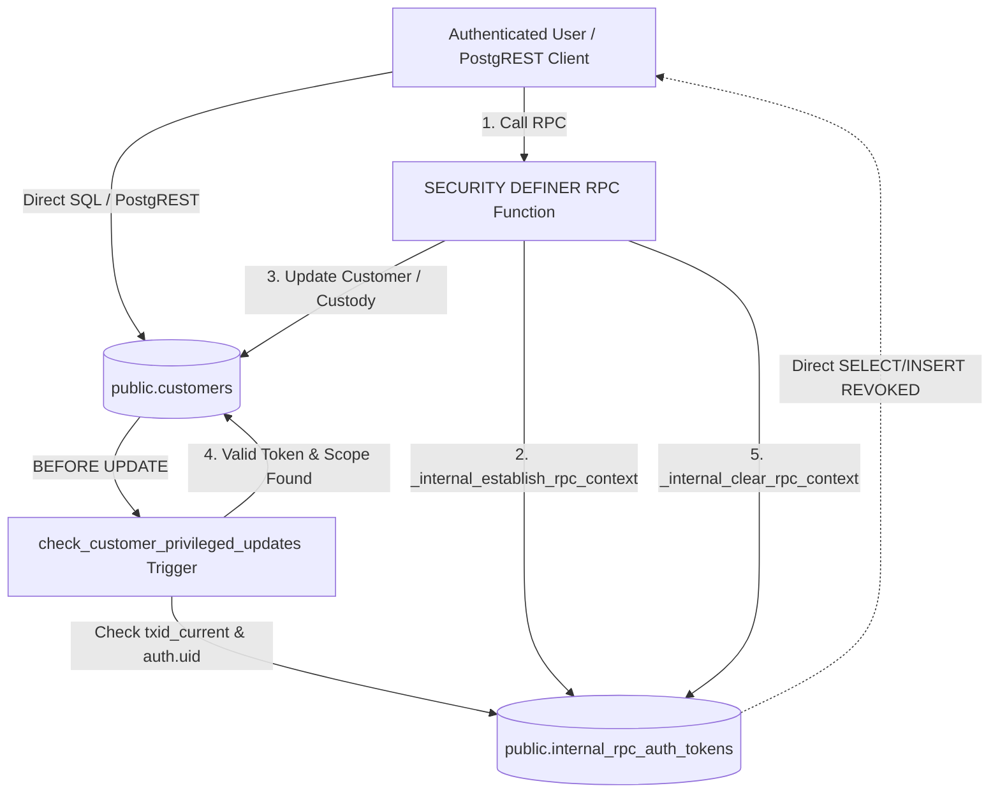

# AQUATRACK ERP — ROUND 7 SCHEMA & SECURITY COMPATIBILITY REPORT
## Comprehensive Pre-Remediation Schema Audit, Invariant Verification & Internal RPC Authorization Security

**Project:** AquaTrack ERP  
**Remediation Phase:** Round 7 (Final Database Integrity, Inventory Conservation, RPC Security & Rollback)  
**Date:** November 2026  
**Status:** Canonical Schema Verified & Hardened  

---

## 1. Executive Summary

Following the independent code audit of Round 6, this document details the complete database schema baseline, constraints, foreign key graphs, Row-Level Security policies, and trigger mechanisms for AquaTrack ERP. 

This audit explicitly addresses the critical defects identified in Round 6:
1. **Scrap-Yard Stock Fabrication:** Resolved by introducing balance locking and validation across all 5 physical location types (`WAREHOUSE`, `VEHICLE`, `CUSTOMER`, `SUPPLIER`, and `SCRAP_YARD`), ensuring outgoing movements from `SCRAP_YARD` deduct from verified scrap balances and terminal scrap conditions cannot be converted to usable inventory.
2. **Real Warehouse Identity Enforcement:** Database-level singleton enforcement (`uq_singleton_warehouse`, `chk_single_default_warehouse`) and active warehouse location ID verification, rejecting any mismatched or arbitrary warehouse IDs.
3. **Mandatory Destination Relationship Validation:** Terminating the practice of silently skipping customer or supplier balance updates. Destination locations must resolve to an active business record (`customers` or `suppliers`) or the entire transaction aborts.
4. **Order Inventory Lifecycle & Reservation:** Deterministic row-locking (`ORDER BY product_id FOR UPDATE`) in `rpc_create_customer_order`, validating available stock ($\text{quantity\_on\_hand} - \text{quantity\_reserved} \ge \text{requested\_quantity}$) and incrementing `quantity_reserved`. Delivery stop execution completes the lifecycle by deducting `quantity_on_hand` and releasing `quantity_reserved`, while order cancellation releases reservations atomically.
5. **Unforgeable Internal RPC Authorization Tokens:** Replacing fragile call-stack inspections (`PG_CONTEXT`) and spoofable custom session variables with a dedicated internal authorization table (`public.internal_rpc_auth_tokens`). This table is strictly inaccessible (`REVOKE ALL`) to all direct callers, tied to `txid_current()` and `auth.uid()`, and domain-scoped to prevent direct table writes.

---

## 2. Canonical Database Schema Baseline

### 2.1 Table Inventory & Primary Keys

| Table Name | Primary Key | Description | Canonical Constraints / Invariants |
|---|---|---|---|
| `public.business_settings` | `id UUID` | Singleton company profile | `is_singleton = true`, `uq_single_business_settings` |
| `public.locations` | `id UUID` | Physical custody entities | `type IN ('WAREHOUSE', 'VEHICLE', 'CUSTOMER', 'SUPPLIER', 'SCRAP_YARD')` |
| `public.warehouses` | `id UUID` | Central depot | `location_id UNIQUE REFERENCES locations(id)`, `is_default = true`, `uq_singleton_warehouse` |
| `public.profiles` | `id UUID` | User auth extension | `id REFERENCES auth.users(id)`, `role IN ('owner', 'staff')`, `uq_single_owner` |
| `public.customers` | `id UUID` | Customer master | `location_id UNIQUE REFERENCES locations(id)`, `customer_type IN ('B2C', 'B2B')`, 5 jar holding fields $\ge 0$ |
| `public.suppliers` | `id UUID` | Vendor & plant master | `location_id UNIQUE REFERENCES locations(id)`, `jars_in_custody >= 0`, `current_payable` |
| `public.products` | `id UUID` | Item catalog | `sku UNIQUE`, `category IN (...)`, `default_sale_price >= 0`, `chk_products_gst_balance` |
| `public.customer_special_prices`| `id UUID` | Contracted tier pricing | `chk_csp_date_range (effective_to >= effective_from)`, `uq_csp_customer_product_date` |
| `public.inventory_balances` | `id UUID` | Warehouse SKU inventory | `uq_inv_warehouse_product (warehouse_id, product_id)`, `quantity_on_hand >= 0`, `quantity_reserved >= 0` |
| `public.stock_movements` | `id UUID` | Dual-entry stock ledger | `movement_type IN ('PURCHASE_RECEIPT', 'POS_SALE', 'DELIVERY_DISPATCH', 'DELIVERY_RETURN', 'ADJUSTMENT_IN', 'ADJUSTMENT_OUT', 'SCRAP_WRITEOFF')` |
| `public.jar_custody_movements` | `id UUID` | Reusable jar tracking | `condition_from/to IN ('FULL_USABLE', 'EMPTY_CLEAN', 'EMPTY_DIRTY', 'DAMAGED_REPAIRABLE', 'DAMAGED_SCRAP')`, 11 allowed movement types |
| `public.orders` | `id UUID` | Customer route orders | `order_number UNIQUE`, `status IN ('PENDING', 'CONFIRMED', 'ASSIGNED', 'OUT_FOR_DELIVERY', 'PARTIALLY_DELIVERED', 'DELIVERED', 'CANCELLED')` |
| `public.order_items` | `id UUID` | Order line items | `quantity > 0`, `unit_price >= 0`, `tax_rate >= 0`, audit columns (`original_price`, `is_price_overridden`) |
| `public.delivery_stops` | `id UUID` | Route stop execution | `status IN ('ASSIGNED', 'EN_ROUTE', 'COMPLETED', 'FAILED', 'CANCELLED')`, physical collection tracking |
| `public.invoices` | `id UUID` | Accrual sales billing | `invoice_number UNIQUE`, `balance_due >= 0`, `status IN ('UNPAID', 'PARTIALLY_PAID', 'PAID', 'CANCELLED')` |
| `public.financial_ledger` | `id UUID` | Double-entry journals | `debit >= 0`, `credit >= 0`, `chk_financial_ledger_nonzero` |
| `public.purchases` | `id UUID` | Supplier purchase PO | `status IN ('DRAFT', 'ORDERED', 'PARTIALLY_RECEIVED', 'RECEIVED', 'CANCELLED')` |
| `public.purchase_items` | `id UUID` | Purchase PO items | `quantity_ordered > 0`, `quantity_received >= 0` |
| `public.pos_sales` | `id UUID` | Counter walk-in sales | `receipt_number UNIQUE`, `payment_method IN ('CASH', 'UPI')` |
| `public.customer_payments` | `id UUID` | Route payment records | `payment_number UNIQUE`, `amount > 0`, `payment_method IN ('CASH', 'UPI', 'CREDIT')` |
| `public.internal_rpc_auth_tokens` | `token_id UUID` | Transaction auth tokens | `txid BIGINT NOT NULL`, `authorized_user_id UUID NOT NULL`, `allowed_scope VARCHAR NOT NULL` |

---

## 3. Detailed Column Specifications & Type Invariants

### 3.1 Locations Table (`public.locations`)
- `id`: `UUID PRIMARY KEY DEFAULT gen_random_uuid()`
- `type`: `VARCHAR(30) NOT NULL CHECK (type IN ('WAREHOUSE', 'VEHICLE', 'CUSTOMER', 'SUPPLIER', 'SCRAP_YARD'))`
- `name`: `VARCHAR(150) NOT NULL`
- `address`: `TEXT`
- `is_active`: `BOOLEAN NOT NULL DEFAULT true`
- `created_at`: `TIMESTAMPTZ NOT NULL DEFAULT pg_catalog.now()`
- `updated_at`: `TIMESTAMPTZ NOT NULL DEFAULT pg_catalog.now()`

> [!IMPORTANT]
> The canonical column is `type`, **not** `location_type`. `SCRAP_YARD` is an authorized first-class location type subject to strict custody conservation.

### 3.2 Inventory Balances (`public.inventory_balances`)
- `id`: `UUID PRIMARY KEY DEFAULT gen_random_uuid()`
- `warehouse_id`: `UUID NOT NULL REFERENCES public.warehouses(id) ON DELETE CASCADE`
- `product_id`: `UUID NOT NULL REFERENCES public.products(id) ON DELETE RESTRICT`
- `quantity_on_hand`: `INTEGER NOT NULL DEFAULT 0 CHECK (quantity_on_hand >= 0)`
- `quantity_reserved`: `INTEGER NOT NULL DEFAULT 0 CHECK (quantity_reserved >= 0)`
- `last_counted_at`: `TIMESTAMPTZ`
- `updated_at`: `TIMESTAMPTZ NOT NULL DEFAULT pg_catalog.now()`
- Constraint: `uq_inv_warehouse_product UNIQUE (warehouse_id, product_id)`

**Available Stock Invariant:**
$$\text{Available Stock} = \text{quantity\_on\_hand} - \text{quantity\_reserved}$$

---

## 4. Remediation Fixes & Technical Architecture

### 4.1 Part 2 — Scrap-Yard Stock Fabrication Fix
In Round 6, outgoing movements specifying a source of type `SCRAP_YARD` bypassed balance validation. In Round 7:
1. `SCRAP_YARD` source movements must compute net available stock from `jar_custody_movements`:
   $$\text{Available Scrap} = \sum \text{quantity}_{\text{in, DAMAGED\_SCRAP}} - \sum \text{quantity}_{\text{out, DAMAGED\_SCRAP}}$$
2. If requested quantity exceeds available scrap, the transaction raises an exception:
   `Scrap yard has insufficient DAMAGED_SCRAP jars. Available: X, Requested: Y.`
3. **Terminal Scrap Invariant:** A jar in `DAMAGED_SCRAP` condition can never be transitioned into `FULL_USABLE`, `EMPTY_CLEAN`, `EMPTY_DIRTY`, or `DAMAGED_REPAIRABLE`. Outgoing scrap movements can only be `SCRAP_WRITEOFF` authorized by the business owner.

### 4.2 Part 3 — Real Warehouse Singleton Identity
1. Enforced a unique index `uq_singleton_warehouse ON public.warehouses ((true))` and CHECK constraint `chk_single_default_warehouse (is_default = true)`.
2. All inventory and jar custody RPCs (`rpc_record_jar_movement`, `rpc_create_customer_order`, `rpc_execute_delivery_stop`, `rpc_complete_pos_sale`, `rpc_cancel_customer_order`) resolve the authoritative canonical warehouse:
   ```sql
   SELECT id, location_id INTO v_default_wh_id, v_wh_location_id FROM public.warehouses WHERE is_default = true LIMIT 1;
   ```
3. Any movement specifying a warehouse location ID differing from `v_wh_location_id` is rejected immediately.

### 4.3 Part 4 — Destination Relationship Validation
In Round 6, destination customer or supplier balance updates were wrapped in `IF v_dst_cust.id IS NOT NULL`, allowing orphan locations to silently skip balance updates. In Round 7:
- When destination is `CUSTOMER`, a corresponding row in `public.customers` matching `location_id` is required. If not found, the transaction raises:
  `Destination customer record not found for location %. Balance update cannot be skipped.`
- When destination is `SUPPLIER`, a corresponding row in `public.suppliers` matching `location_id` is required. If not found:
  `Destination supplier record not found for location %. Balance update cannot be skipped.`

### 4.4 Part 5 — Order Inventory Lifecycle & Reservation
To eliminate overselling and prevent double inventory deductions:
1. **Order Creation (`rpc_create_customer_order`):**
   - Deterministically locks `inventory_balances` rows:
     ```sql
     SELECT * FROM public.inventory_balances WHERE warehouse_id = v_default_wh_id AND product_id IN (...) ORDER BY product_id FOR UPDATE;
     ```
   - Checks available stock: $\text{quantity\_on\_hand} - \text{quantity\_reserved} \ge \text{requested\_quantity}$.
   - Increments `quantity_reserved = quantity_reserved + requested_quantity`.
2. **Delivery Completion (`rpc_execute_delivery_stop`):**
   - Deducts delivered items from `quantity_on_hand` and releases `quantity_reserved`:
     $$\text{quantity\_on\_hand} = \text{greatest}(0, \text{quantity\_on\_hand} - p\_actual\_delivered)$$
     $$\text{quantity\_reserved} = \text{greatest}(0, \text{quantity\_reserved} - p\_actual\_delivered)$$
   - Records `stock_movements` with `movement_type = 'DELIVERY_DISPATCH'`.
3. **Order Cancellation (`rpc_cancel_customer_order`):**
   - Releases any remaining undelivered reserved quantity:
     $$\text{quantity\_reserved} = \text{greatest}(0, \text{quantity\_reserved} - \text{undelivered\_quantity})$$
   - Marks order and stops `CANCELLED`, reversing invoice balances.

### 4.5 Part 6 — Internal RPC Authorization Architecture
To prevent trigger bypasses while preventing direct table manipulation:
1. Created `public.internal_rpc_auth_tokens`:
   - Contains: `txid BIGINT`, `rpc_name VARCHAR`, `authorized_user_id UUID`, `allowed_scope VARCHAR`, `created_at TIMESTAMPTZ`.
   - `REVOKE ALL ON TABLE public.internal_rpc_auth_tokens FROM PUBLIC, anon, authenticated;`
2. Functions `_internal_establish_rpc_context` and `_internal_clear_rpc_context` are `SECURITY DEFINER` with search path `public, pg_temp` and execute permissions revoked from public, anon, and authenticated users.
3. Triggers `check_customer_privileged_updates` and `check_supplier_privileged_updates` verify:
   $$\text{txid} = \text{txid\_current}() \quad \text{AND} \quad \text{authorized\_user\_id} = \text{auth.uid}()$$
4. Allowed scopes:
   - `JAR_CUSTODY_ONLY`: Authorizes jar holding updates; strictly blocks changes to `current_balance` and `total_deposit_held`.
   - `CUSTOMER_ORDER_BALANCE_ONLY`: Authorizes `current_balance` updates; strictly blocks changes to jar holdings and deposits.
   - `DELIVERY_STOP_EXECUTION`: Authorizes delivered jar holdings and payment balance settlements.
   - `PURCHASE_RECEIPT`: Authorizes supplier jar custody and payable updates.
5. All direct table writes without an active token and without owner role raise explicit exceptions.

---

## 5. Security & Permission Boundaries



**Security Guarantees:**
1. **Direct PostgREST Access Denied:** A malicious client calling `PATCH /rest/v1/customers` cannot forge a row in `internal_rpc_auth_tokens` because all table permissions are revoked.
2. **Session Bleed Prohibited:** Authorization is keyed to `txid = txid_current()`, guaranteeing tokens cannot bleed across transactions or pooled connections.
3. **Domain Isolation:** Calling `rpc_record_jar_movement` cannot alter financial balances because the token scope is restricted to `JAR_CUSTODY_ONLY`.
